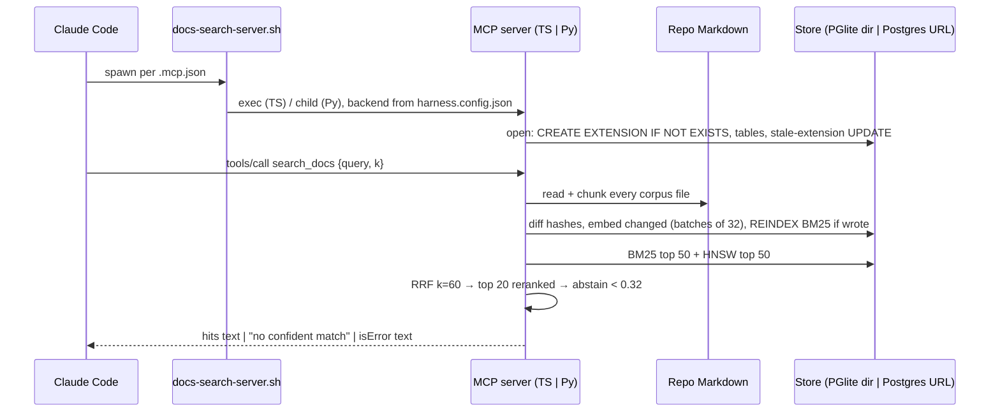

# RAG extraction research — how retrieval works here today, and where it would cut out

**Who reads this:** the maintainer deciding whether to move docs retrieval into its own repository and product, and whoever writes the synthesis (`README.md` in this directory). **It owns:** the invocation path as shipped, the pipeline stage by stage, every place the retrieval code depends on the harness, an assessment of which half could stand alone, the gaps for a large-docs user, and a proposed seam. **It does not own:** how comparable products are packaged (`02-distribution-shapes.md`), remote sources, managed Postgres or connection security (`03-sources-database-security.md`), or how the harness should consume the extracted product beyond one short subsection.

## How this was researched

Date: 2026-10-28. Route: reading this repository at `dev` (`2ace325d`) only — source, templates, tests, shipped docs and the eval record. No command was run against a database or a model. The fork itself used no web source. The licence URLs in §7 were checked by this file's reviewer (`reviews/01-current-mechanism.md`, Should Fix 1) and are carried here with that provenance.

Main sources: `docs/retrieval.md`, `docs-retrieval-service/README.md`, `docs/cli.md` §2/§7/§11, `docs/config.md` §5, `cli/src/retrieval/*.ts`, `cli/src/commands/docs.ts`, `cli/src/doctor/checks.ts`, `cli/src/generators/repoRoot.ts`, the two retrieval templates, `cli/templates/scripts/docs-search-server.sh`, `docs-retrieval-service/src/harness_docs_retrieval/*.py` and its compose and Docker files, `plugin/agents/`, `plugin/hooks/hooks.json`, `evals/docs-retrieval/`, and the headings of `docs/retrieval-eval-results.md`.

Three kinds of statement, as in `docs/copilot-foundry-research.md` → `## How this was researched`:

- **Documented** — a file in this repository states or implements it (cited `path:line` or `path → ## heading`), or a web URL given.
- **Inference** — this fork's own conclusion.
- **Unconfirmed** — no source checked states it; each is marked.

Unlabelled sentences in a paragraph that cites a source are Documented.

**Framing.** Per `_brief.md`, today's stack is a starting point, not a constraint. The product need not keep `pg_textsearch`, pgvector, PGlite or the current models. Where this file describes them, it describes what exists, not what must ship.

---

## 1. The invocation path, end to end

### Who starts the server

1. **`init` writes the registration.** When `retrievalApplies(config)` holds — `phases.docs === true && docs.retrieval === true` (`cli/src/config/model.ts:637`) — `init` merges a `harness-docs` stdio entry from `cli/templates/repo/mcp.retrieval.json` into `.mcp.json`. The entry runs `command: "bash"` with one argument, `<scriptsDir>/docs-search-server.sh`, and an empty `env` object (`cli/src/generators/repoRoot.ts` → `retrievalWiring`).
2. **The agent runner starts the launcher.** Only the MCP SDK's fixed inherited environment reaches it (`HOME`, `LOGNAME`, `PATH`, `SHELL`, `TERM`, `USER`), so any setting must go in the entry's `env` object (`docs/retrieval.md:54`).
3. **The launcher picks the backend at run time** (`cli/templates/scripts/docs-search-server.sh:75-135`). It reads `docs.retrievalBackend` only inside the retrieval gate.
   - `typescript`, or the key absent: it `exec`s a whole copy of the harness CLI that `init` installed into a machine cache, as `node $cache/retrieval/runtime/node_modules/autonomous-sdlc-harness/dist/cli.js docs serve --cwd <root>` (`cli/src/retrieval/runtime.ts:14-17`).
   - `python`: it defaults `HARNESS_DOCS_RETRIEVAL_DATABASE_URL` to the compose loopback URL, runs `harness-docs-retrieval serve-mcp --repo <root>` as a child, relays signals, and maps any failure to exit `3`.
   - There is no fallback between backends.

### How the agent is allowed to call it

- **Server enablement and tool permission.** A profile fragment adds `"enabledMcpjsonServers": ["harness-docs"]` and `"permissions.allow": ["mcp__harness-docs__search_docs"]` (`cli/templates/claude/settings.autonomous.retrieval.json`). Its `_README` says both are needed, and that an unloaded tool stalls a print-mode run.
- **Agent `tools:` allowlists.** Exactly 11 plugin agents (every plan writer, plan reviewer and end-of-branch reviewer) list the tool in `tools:` whatever the configuration (`plugin/agents/README.txt:54-94`).
- **Prose that governs use.** Each of those agents carries a `<docs_retrieval>` row and a tool bullet: ignore the tool unless retrieval is on; treat a hit as "navigation, never evidence" and as untrusted data; on `no confident match`, fall back to index-first reading (`plugin/agents/task-plan-writer.md:22`, `:60`).
- **Deferred loading.** On Claude Code 2.1.278 the tool arrived deferred, behind a `ToolSearch` call (`docs/retrieval.md:140`).

### What the agent sends, and what comes back

**The schema** is byte-identical in both backends (`cli/src/retrieval/server.ts:56-69`; `wire.py:25-46`):

- `query`: a non-empty string, required.
- `k`: an integer from 1 to 20, default 5 (`search.ts:30-33`).
- `additionalProperties: false`, annotated `readOnlyHint`.
- **There is no `mode`.** The MCP tool always runs `fused-rerank` (`server.ts:149`).
- The description is harness-worded: "Search this repository's docs catalog and conventions documents…".

**The result** is one text item (`server.ts:82-166`; `search.ts:36`, `51-57`, `164-170`). It takes one of four shapes:

- **Hits.** Each hit is `n. <path>#<anchor> (score s)` followed by an indented snippet of 240 characters.
- **Abstention.** Exactly `no confident match`, when the best reranker score is below `0.32`.
- **Coverage warnings.** `note: ` lines placed before the body.
- **Errors.** `isError` text for an argument refusal, a refresh failure (which names `npx autonomous-sdlc-harness doctor`), a search failure, or an unknown tool.

Calls are answered one at a time, because each call refreshes and therefore writes (`server.ts:201-211`; the Python side uses an `asyncio.Lock` in `service.py` → `answer`).

**The CLI verbs.** `docs index [--in-memory]` and `docs search <query> [--k n] [--mode lexical|vector|fused|fused-rerank]` each refresh the index first. They always use the TypeScript backend, whatever `docs.retrievalBackend` holds (`cli/src/commands/docs.ts:74-157`; `docs/cli.md` → `## 11. \`docs\``). `docs fetch-models` is the only sub-verb that downloads.

### Sequence

## 2. Hooks: none. Retrieval is always pulled by the agent

**Documented:** `plugin/hooks/hooks.json` registers only `PreToolUse` hooks on `Bash`, and contains no `mcp` string. No hook script, command or instruction document mentions `search_docs`, and nothing injects retrieved text into a prompt. **Inference:** no hook has to move at the seam, and no harness prompt depends on retrieval being present.

## 3. Pipeline internals

| Stage | TS (`cli/src/retrieval/`) | Python (`…/harness_docs_retrieval/`) | Harness-specific | Generic |
|---|---|---|---|---|
| Corpus | `corpus.ts` | `corpus.py` | Input comes from `harness.config.json` (`docs.root` + `layers[].conventions`), confined to the repo (`corpus.py:96-134`). | Recursive walk; a missing path is a warning. |
| Chunk | `chunk.ts` | `chunk.py` (parity-tested) | The wrapper-heading fold is tuned to house templates (`docs/retrieval.md:15`). | Markdown only: split on `##`/`###` outside fences, GitHub anchors, sha256 change signal, no size cap. |
| Embed | `models.ts` (bge-small q8 ONNX) | `models.py` (bge-small fp32) | The cache path and the stub variable carry harness names. | Pinned revisions, offline loads, English. |
| Store | `store.ts`, PGlite at `<stateDir>/docs_index` (`:84`) | `store.py`, Postgres by URL | `stateDir` sets the location. | `meta` + `chunks`, HNSW cosine, `pg_textsearch` BM25 (`english`). |
| Refresh | `refresh.ts` | `refresh.py` | — | Incremental by key and hash; an embedder change clears the index; `REINDEX` after any write (`docs/retrieval.md:17`). |
| Search / rerank | `search.ts` | `search.py` | — | Four modes, 50 candidates per arm, RRF 60, top 20 to a cross-encoder. |
| Abstain | `0.32` | same | Calibrated on harness corpora and one catalog (`docs/retrieval-eval-results.md` → `## Threshold calibration`). | `fused-rerank` only. |
| Log | `queryLog.ts` (`AUTONOMOUS_SDLC_HARNESS_RETRIEVAL_LOG`) | none; a `search_ms` line on stderr | The variable name. | JSONL per call. |
| Serve | `server.ts` (stdio MCP) | `mcp_server.py` (stdio), `http_app.py` (HTTP) | Server name, description, remedy text. | MCP tool, HTTP JSON. |

**Inference:** the harness-specific surface is thin: the corpus input, the names, the wording and the index location. Chunk → embed → store → search → rerank → abstain is generic. It is also replaceable, given the framing above.

### The HTTP surface that already exists

`serve-http` (`http_app.py:57-113`) has two endpoints:

- `POST /search` takes `{query, k?, mode?}`. Unlike MCP it can select any of the four modes. It returns `{text, mode, abstained, best_rerank_score, hits[{ref,path,anchor,heading,snippet,score}], notes, search_ms}`, or `400`/`500 {"error"}`.
- `GET /health` returns `200 {status, embedder, reranker}`, or `503` carrying the raw exception string (`:101-106`).

**Every `POST /search` runs the same per-call refresh, so every query writes to the database** (`evals/docs-retrieval/python-backend.mjs:81`).

Two things use it: the service image's default command (`docs-retrieval-service/Dockerfile:46`, which compose publishes on `127.0.0.1:8080`), and the eval runner's Python arms (`python-backend.mjs:53`). The launcher never does.

**It is not shipped.** The package "is not published to any package index" (`docs/retrieval.md:196`). Of the three workflows in `.github/workflows/`, the only Python job is `uv audit` on `uv.lock` in `supply-chain.yml`, and none builds or pushes a wheel or image. The eval record says the service image "is not in an adopter's path" (`docs/retrieval-eval-results.md:28246`). There is no auth, TLS or CORS.

## 4. Coupling inventory

**Trivial** means a rename or a deletion. **Moderate** means a decision plus code. **Hard** changes what the product is.

| # | Coupling | Where | Rank |
|---|---|---|---|
| 1 | The corpus is read from `harness.config.json`. Python **raises without that file even when `--docs-root` is given** | `service.py:83-101`; `corpus.py:96`; `corpus.ts` | **Moderate:** needs its own source config. |
| 2 | Gate `phases.docs && docs.retrieval` (TS only) | `session.ts:37-41` | Trivial. |
| 3 | Index at `<stateDir>/docs_index`; `init` gitignores it | `store.ts:84`; `cli/src/generators/repoRoot.ts:622` | Trivial. |
| 4 | Wire names `harness-docs` / `search_docs`, quoted by 11 agents and 2 templates | `server.ts:35-42`; `wire.py`; `plugin/agents/README.txt:84-90` | Moderate. A configurable server name would let the harness keep its string. |
| 5 | Description and remedy text naming the harness | `server.ts:58`, `:137`; `service.py:245`; `session.ts:39`, `:47` | Trivial. |
| 6 | `AUTONOMOUS_SDLC_HARNESS_RETRIEVAL_STUB` (read by both backends, passed through by `compose.yaml`) and `…_RETRIEVAL_LOG` | `stubs.py:21`; `queryLog.ts:53`; `models.ts` | Trivial. |
| 7 | Cache paths `…/autonomous-sdlc-harness/retrieval/{runtime,models}`, mirrored in the launcher and in `cli/templates/github/workflows/harness-run.yml:600`, `:938` | `runtime.ts:20-27` | Trivial for the product; the harness mirrors move with it. |
| 8 | **The TS backend ships inside the harness npm package** as optional peers. `init` installs the whole CLI plus peers into a runtime directory, because `npx` cannot resolve project peers. It imports `HarnessConfig`, `HarnessError`, `Reporter` and `core/paths` | `cli/package.json`; `runtime.ts`; `setup.ts`; `docs/retrieval.md:71-73` | **Hard.** |
| 9 | Model fetching inside `init` (`setup.ts` spawns `docs fetch-models`, 900 s timeout) | `setup.ts:46` | Moderate; Python has its own `fetch-models`. |
| 10 | `doctor`: six checks; the Python three parse `self-check` stdout | `checks.ts:5767-6060`; `pythonBackend.ts:13-31` | Moderate. |
| 11 | **Byte parity between backends:** `jscompat.py` ports JS semantics, and five parity tests run TS through `cli/dist` (`ts_bridge.*`) | `docs-retrieval-service/README.md:155-163` | **Moderate to hard.** Goes away if only one implementation remains. |
| 12 | Eval harness `evals/docs-retrieval/` (6 066 lines; **15 modules import `../../cli/dist/…`**), its corpora, query sets and the 32k-line results file | e.g. `args.mjs:29`, `results.mjs:30-31` | Moderate. It is the product's only quality evidence, and it is bound to the TS module layout. |
| 13 | Python provisioning clones this repo at the harness tag `autonomous-sdlc-harness--v<version>` | `docs/retrieval.md:185-200` | Trivial; it becomes the product's own release. |
| 14 | Harness-side wiring and housekeeping: the launcher and `harness-run-lib.sh`; schema keys `docs.retrieval`/`docs.retrievalBackend`; gate 13, gate 10, `scripts/python-service.sh`, the `uv-audit` and `model-revisions` jobs; the `cli/test/docs-retrieval*` and `retrieval-*` suites; the remote job's TS-only provisioning | `docs-search-server.sh`; `schemas/harness.config.schema.json:279-288`; `scripts/run-gates.sh:227`; `supply-chain.yml:62-114`; `docs/retrieval.md:262` | Launcher and schema stay. CI, gates and tests are moderate to recreate on whichever side keeps the code. |

## 5. What already stands alone

**The Python service** (`docs-retrieval-service/`) already has its own package, console script and version (`pyproject.toml`, `0.1.0`). It has its own `HARNESS_DOCS_RETRIEVAL_*` variables (except the stub variable, §4 #6) and its own weight cache. Its verbs are `fetch-models`, `index`, `self-check`, `serve-mcp` and `serve-http`. Its store takes a Postgres by URL, and it ships a compose stack, a weight-free non-root service image and a Postgres 18 image that builds pgvector 0.8.7 and `pg_textsearch` v1.5.1. It reads only two harness keys and applies no harness gate (`service.py:13-15`).

To become a product (**Inference**) it needs:

- its own corpus config;
- a published artifact;
- auth and TLS on HTTP;
- reconnect;
- a pool instead of one connection behind a lock;
- a query log;
- a `license` field (absent from `pyproject.toml`);
- the input and tenancy work in §6.

**The TypeScript backend** gives a zero-server, per-checkout index (`docs/retrieval.md:269`), but it is bound to the harness package (§4 #8). PGlite is in-process and single-writer, so it fits a local mode, not a shared one (**Inference**).

**Measured facts that matter to a product** (cited, not re-derived):

| Fact | Source |
|---|---|
| On the one real catalog (156 files, 1,960 chunks), model-free `lexical` scored recall@5 **0.909** against `fused-rerank`'s **0.795**, at p50 1.7 ms against 1099.7 ms; single repetition | `docs/retrieval-eval-results.md:4607`, `:4610` |
| `fused-rerank` is below plain `fused` on every primary relevance column, on all three corpora | `→ ## The shipped default against fusion alone` |
| Against agent navigation, the rule says **withdrawn**. It is kept opt-in because it is unoptimised and unmeasured on large or non-technical catalogs | `→ ### The verdict`, `### The maintainer's decision` |
| The Python and TS backends **disagree, for reasons not all identified**; Python buys no relevance | `→ ### Which case this is`, `### The trade-off, stated` |
| Cold build at 1,960 chunks takes about 111–128 s on an M4 and is dominated by embedding | `→ ## Cold build and index size` |
| `REINDEX INDEX chunks_bm25` after each writing refresh holds `ACCESS EXCLUSIVE`; its duration is **not measured** | `docs-retrieval-service/README.md:153` |

Single connection, single tenant, Linux and publication are covered in §6.

**Inference:** the record does not yet show that the semantic half earns its cost. Large and non-technical catalogs, the product's target, are exactly what is unmeasured.

## 6. Gaps for the target user (large or very large non-code docs, plug-in setup)

| Gap | Kind | Evidence |
|---|---|---|
| Markdown only (`*.md`); no PDF, HTML, DOCX, RST or plain text | Documented | `corpus.py:72`; `chunk.ts` header |
| No chunk-size cap. What happens past the models' window is **Unconfirmed**; handling it is named as open work | Documented / Unconfirmed | `→ ### The maintainer's decision` |
| Local files only, confined inside `--repo`; no remote source | Documented | `corpus.py:39-52`, `:109-110` |
| `harness.config.json` required even with `--docs-root` | Documented | `service.py:83-101` |
| **Refresh before every query:** every call reads and chunks every file and lists every stored hash. Cost at 10k–100k files is unmeasured, and worse over the image's bind mount (`/repo:ro`) or a network mount | Documented (mechanism: `refresh.py:77-84`, `refresh.ts:83-86`) / Inference (cost) |
| Cold build is about 57 ms/chunk on an M4, so 100k chunks extrapolates to about 1.6 h; the repo deliberately publishes no projection | Inference; `docs/retrieval.md:88` |
| **Not a plain connection string.** The current store needs Postgres **≥ 18.4** (pg_textsearch 1.5.1 will not load on 18.2), `shared_preload_libraries=pg_textsearch`, and a role that can run `CREATE EXTENSION IF NOT EXISTS vector; … pg_textsearch` (issued on every open) and `ALTER EXTENSION … UPDATE` (issued when an installed version is stale). Which managed providers allow this is fork 03's | Documented: `postgres/Dockerfile:15`; `compose.yaml`; `store.py:89-93`, `:130-133`; `README.md:147` |
| Single tenant: two corpora on one database delete each other's chunks, and `doctor` cannot tell | Documented | `README.md:146`; `docs/retrieval.md:246` |
| One connection behind one lock, so HTTP serves one search at a time; no reconnect after a Postgres restart | Documented | `README.md:150-151` |
| No auth, no TLS; local-only, "no hosted API and no key" | Documented | `http_app.py`; `compose.yaml`; `README.md:7` |
| English-only models and `english` BM25 config | Documented | `docs/retrieval.md:31`; `store.ts` |
| The MCP tool cannot choose `mode`, so the better-measured `lexical`/`fused` is out of an agent's reach | Documented | `server.ts:149` |
| No filters or pagination; fixed 240-character snippet | Documented (absent from schema) | `server.ts:59-67` |
| Not published; Linux never measured | Documented | `docs/retrieval.md:159`, `:196` |

## 7. The cut

**What moves.**

- `docs-retrieval-service/` in full;
- `scripts/python-service.sh`;
- the `uv-audit` and `model-revisions` jobs;
- the eval harness `evals/docs-retrieval/` with its record (`docs/retrieval-eval.md`, `docs/retrieval-eval-results.md`);
- the design-of-record parts of `docs/retrieval.md`.

The code moves as a **starting point**. The new product may replace the lexical engine, the vector store, the models or the embedded mode (`_brief.md`). If it does, the eval harness is what measures the replacement, which is the strongest reason to move it (**Inference**).

**Decision for the maintainer.** Should `cli/src/retrieval/` (TS/PGlite) move as an embedded mode, stay, or be retired? Moving it keeps a zero-server mode, but also keeps two implementations with unexplained disagreement plus the parity machinery that holds them together. A single-implementation product would drop `jscompat.py` and the `ts_bridge` tests.

**What stays in the harness:** the launcher, the two templates, the `docs.*` schema keys, the agent grants and `<docs_retrieval>` prose, the `doctor` checks (reduced to grading the product's self-check), and the Actions cache wiring.

**Minimum changes at the seam:**

- the product's own source config in place of `docs.root`/`layers[]`;
- names moved off `AUTONOMOUS_SDLC_HARNESS_*` and `…/autonomous-sdlc-harness/…`;
- neutral wording;
- a corpus or tenant key.

### The contract the harness would consume afterwards

**Inference.** The harness needs:

- a stdio MCP command taking a corpus definition;
- a stable or configurable server name, so `mcp__harness-docs__search_docs` survives;
- the result text format of §1;
- a machine-readable readiness check. `self-check` already provides one: lines rendered by `self_check.py` → `CheckLine.render` (`:40`) and parsed by `pythonBackend.ts` → `parseSelfCheck`.

The harness pins the product's version.

### Licence and NOTICE

- **Repository code (Documented).** Apache-2.0, with `NOTICE` carrying the copyright and the section 4(d) reproduction duty (`NOTICE:6`, `cli/NOTICE:6`). The maintainer can relicense or re-NOTICE a new repository as sole holder; whether there are third-party contributions in these paths is **Unconfirmed** (`git log` authorship was not audited). `pyproject.toml` has no `license` field.
- **Dependencies (Documented, via the review):**
  - `pg_textsearch` is under the PostgreSQL License (https://raw.githubusercontent.com/timescale/pg_textsearch/main/LICENSE);
  - pgvector is under the PostgreSQL License (https://raw.githubusercontent.com/pgvector/pgvector/master/LICENSE);
  - psycopg 3 is under LGPL-3.0 (https://raw.githubusercontent.com/psycopg/psycopg/master/LICENSE.txt). A wheel or image that bundles it carries LGPL obligations.
- **Models (Documented).** bge-small-en-v1.5 is MIT (`docs/retrieval.md:31`). The ms-marco-MiniLM-L6-v2 card says Apache-2.0 (https://huggingface.co/cross-encoder/ms-marco-MiniLM-L6-v2). Weights are fetched by the user, not redistributed (`Dockerfile` header). Baking them in would require attribution (**Inference**).
- **The one named risk.** MS MARCO, the reranker's training data, is "intended for non-commercial research purposes only" (https://microsoft.github.io/msmarco/). Whether that reaches the Apache-2.0 weights is **Unconfirmed**. It matters for a commercial or hosted product, and swapping the reranker removes it.

## Open questions

1. Is the product Postgres-only, does it keep an embedded mode (PGlite or an equivalent), or does it change engines altogether? This decides whether two implementations and the parity suite move.
2. What should the default mode or stack be? That needs a measurement on a *large, non-technical* catalog first, given lexical's lead on the one real catalog.
3. Should per-query refresh stay, or give way to explicit `index` plus a watcher or webhook? It needs a refresh-only latency at 10k and 100k files, including over a mount.
4. Tenancy: a `corpus_id` column, or one schema or database per corpus? This also decides how far the `REINDEX` lock reaches.
5. How long does `REINDEX` take at scale? It is unmeasured; the probe `--reindex-cost` exists (`docs/retrieval-eval.md` → `### The BM25 index-state probe`).
6. What do the embedder and reranker do with sections past their window, and what chunk cap should be added?
7. If HTTP becomes the primary API: auth, TLS, a connection pool, reconnect, and a refresh that is not a write per query.
8. Does Linux behave the same? Gate 10 has never run there.
9. Does the MS MARCO non-commercial term reach the reranker weights for the intended offer? And what do psycopg's LGPL obligations mean for a bundled wheel or image?

## Fork verdict

Retrieval here is pulled by agents only, with no hooks. Its harness coupling sits in a thin band: the corpus read from `harness.config.json`, names and paths, wording, the launcher, and `init`/`doctor` provisioning. The Python service is the natural extraction candidate: it already has its own package, verbs, cache, Postgres-by-URL store, compose stack and unshipped HTTP API, while the TypeScript backend is entangled with the harness npm package. The minimum cut is to move `docs-retrieval-service/` and the eval record, give the product its own source config and a tenant key, and leave the launcher, grants and schema keys in the harness, consuming a stdio MCP command plus `self-check`. Because the stack is not locked, the moved code is a starting point, and the eval harness is what should judge any replacement engine or model. The larger risk is the product claim, not the seam: the one real measurement favours lexical, the backends disagree, and the §6 gaps all bear on large-docs users. Confidence is high on the mechanism and coupling and moderate on the cut, which turns on Open questions 1–3.

## Review response

Responding to `reviews/01-current-mechanism.md`.

| Finding | Action |
|---|---|
| SF1 — licences | Applied. pg_textsearch, pgvector and psycopg are relabelled Documented, with URLs and review provenance. The MS MARCO non-commercial term is kept as the one named risk. OQ9 is narrowed to that risk plus LGPL. |
| SF2 — remote Postgres requirements | Applied as a §6 row: ≥ 18.4, preload, and a role able to create and update extensions; fork 03 is pointed to for providers. One precision against the review: `ALTER EXTENSION … UPDATE` is issued only when an installed version is stale, while `CREATE EXTENSION IF NOT EXISTS` is issued on every open. The row says so. |
| SF3 — "README says" attribution | Fixed to "the eval record says" (`docs/retrieval-eval-results.md:28246`). |
| SF4 — `supply-chain.yml` | Fixed: the only Python job is `uv audit`, and none builds or pushes a wheel or image. |
| SF5 — ten modules | Fixed to fifteen. |
| SF6 — `harness-run.yml` path | Fixed to the full path, `:600` and `:938`. |
| SF7 — stub variable in §5 | Added "(except the stub variable, §4 #6)". |
| SF8 — length | Cut along the listed lines: prose and error-string lists shortened, the diagram kept and slimmed, §4 rows 11 and 15–18 folded into one, the §5 facts table trimmed, §6 is the single home for the gaps, and the licence section is rewritten. |
| SF9 — verdict length | Now 7 sentences. |
| NH1 — gitignore citation | Applied (`repoRoot.ts:622`). |
| NH2 — `self-check` citation | Applied (`self_check.py:40`, `parseSelfCheck`). |
| NH3 — HTTP refresh writes | Applied in §3 and OQ7. |
| NH4 — bind-mount refresh cost | Applied as a clause in §6 and OQ3. |
| Brief framing (stack not locked) | Added a framing note to the method section. "The cut", §3 and the verdict now treat today's stack as a starting point. |
